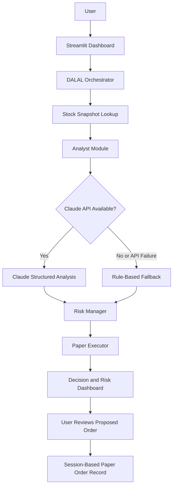

# 📈 DALAL — AI Multi-Agent Indian Market Research Agent


**DALAL** is an AI-assisted Indian stock market research prototype built with Python and Streamlit. It combines LLM-generated stock analysis, rule-based risk calculations, and paper-order previews in an interactive dashboard.

The project demonstrates how AI-assisted financial research can be organized into a structured workflow: retrieve a stock snapshot, generate an analytical assessment, calculate a risk-managed position, and prepare a simulated order for review.

> **Disclaimer:** DALAL is an educational prototype. Its built-in stock snapshots are static, unknown symbols may receive randomly generated demo prices, and paper orders are stored in the current Streamlit session. It does not provide verified live market data, investment advice, or real broker execution.

---

## 📌 Table of Contents

- [Overview](#-overview)
- [Project Objectives](#-project-objectives)
- [Key Features](#-key-features)
- [System Architecture](#-system-architecture)
- [Workflow](#-workflow)
- [Agent and Module Details](#-agent-and-module-details)
- [Risk Management Logic](#-risk-management-logic)
- [Technology Stack](#-technology-stack)
- [Project Structure](#-project-structure)
- [Installation and Setup](#-installation-and-setup)
- [Configuration](#-configuration)
- [How to Use](#-how-to-use)
- [LLM Integration and Demo Mode](#-llm-integration-and-demo-mode)
- [Current Limitations](#-current-limitations)
- [Future Improvements](#-future-improvements)
- [Security Considerations](#-security-considerations)
- [Author](#-author)
- [Disclaimer](#-disclaimer)

## 📖 Overview

Financial market research involves interpreting company information, evaluating possible market signals, and considering the risk of a potential position. DALAL explores how these activities can be organized into a modular application with an AI-assisted analysis stage and a deterministic risk-management stage.

The application currently supports a predefined collection of Indian stock symbols, a selection of trading strategies, configurable risk profiles, and an interactive decision dashboard.

When an API key is available, the application can use Anthropic Claude to generate structured stock-analysis output. Without an API key, it uses a basic rule-based fallback for demonstration purposes.

The risk manager calculates a position preview using a configured portfolio value, available cash, a risk-profile cap, and fixed stop-loss and target percentages. The paper executor prepares a simulated order record without connecting to an exchange or brokerage.

### What DALAL demonstrates

- Integrating an LLM into a Python application.
- Structuring AI output as JSON for downstream processing.
- Separating AI-generated analysis from deterministic risk calculations.
- Building an interactive financial dashboard with Streamlit.
- Managing session-based analysis logs and paper-order records.
- Designing a foundation for future multi-agent financial research systems.

## 🎯 Project Objectives

1. **AI-assisted stock analysis:** Generate a structured assessment of a selected stock using the available stock snapshot and an LLM when configured.
2. **Risk-aware position planning:** Calculate a proposed quantity, stop-loss, target price, position value, and estimated maximum loss.
3. **Modular architecture:** Separate orchestration, analysis, risk calculations, and paper-order preparation.
4. **Interactive visualization:** Present the analysis and risk metrics through a dashboard.
5. **Simulation-first execution:** Allow users to review and record paper orders without placing real trades.
6. **Graceful demonstration mode:** Keep the application usable without an Anthropic API key through a basic fallback analysis.

## ✨ Key Features

### 🤖 AI-assisted stock analysis

When Anthropic Claude is configured, the analyst requests structured output containing:

- Trading signal: BUY, SELL, or HOLD.
- Confidence score.
- Indicative price target.
- Key analytical factors.
- Support and resistance estimates.
- Indian market context.
- A concise analytical summary.

These outputs are model-generated assessments, not independently verified market facts.

### 🛡️ Rule-based risk management

The risk manager uses a predefined portfolio value, available cash, and one of three risk profiles:

- Conservative
- Moderate
- Aggressive

It generates a position preview containing the estimated quantity, entry price, stop-loss, target, position value, and maximum loss.

### 🧾 Paper-order preview

Users can review a proposed order before recording it as a paper order. The application does not submit orders to NSE, BSE, or any broker.

### 📊 Interactive Streamlit dashboard

The interface presents:

- Stock and exchange selection.
- Trading-strategy selection.
- Risk-profile selection.
- AI-generated or fallback analysis.
- Entry, target, stop-loss, and quantity.
- Risk indicators and maximum-loss estimates.
- Analysis logs and recent paper orders.

### 🇮🇳 Indian market focus

The built-in stock dictionary includes examples such as RELIANCE, TCS, INFY, HDFCBANK, ICICIBANK, SBIN, TATAMOTORS, SUNPHARMA, and other Indian equities.

The symbol list is a predefined demonstration dataset, not a live exchange feed.

### 🧠 LLM fallback

If the application is run without an API key, it can use a simple P/E-based heuristic to generate a basic signal. This mode is intended for demonstrating the workflow rather than producing reliable financial analysis.

## 🏗️ System Architecture

DALAL uses one Python orchestrator to coordinate several functional stages. Although the project is described as a multi-agent system, the current implementation is a sequential pipeline rather than a group of independently operating autonomous agents.



### Architecture components

| Component | Responsibility |
|---|---|
| Streamlit UI | Collects inputs and displays results |
| Orchestrator | Coordinates the analysis pipeline |
| Stock lookup | Returns predefined snapshots or a generated demo price for unknown symbols |
| Analyst module | Requests Claude analysis or invokes the fallback heuristic |
| Risk manager | Calculates position and risk estimates using Python rules |
| Paper executor | Creates a simulated order preview |
| Session state | Stores analysis history and paper-order records during the session |

## 🔄 Workflow

1. **Input selection:** The user selects a stock symbol, exchange, strategy, and risk profile.
2. **Stock lookup:** The application retrieves a predefined stock snapshot or generates a demo price for an unknown symbol.
3. **Analysis:** The analyst uses Claude when an API key is configured. Otherwise, the fallback heuristic is used.
4. **Risk calculation:** The risk manager estimates position size, stop-loss, target price, and maximum loss.
5. **Decision assembly:** The orchestrator combines the analysis and risk output.
6. **Order preview:** The application prepares a paper-order preview for the proposed position.
7. **User confirmation:** If the signal is not HOLD, the user can choose to record a paper order.
8. **Dashboard update:** The decision, logs, and recent paper orders are displayed in the interface.

## 🧩 Agent and Module Details

### 1. Orchestrator

The `DalalAgent` class coordinates the end-to-end pipeline.

Responsibilities:

- Retrieve the selected stock snapshot.
- Invoke the analyst or fallback.
- Collect analytical factors and logs.
- Pass the result to the risk manager.
- Construct the decision and paper-order preview.

The orchestrator coordinates modules in sequence; it does not currently implement independent agent planning, autonomous delegation, or inter-agent negotiation.

### 2. Analyst module

The analyst constructs a prompt containing the selected stock, exchange, strategy, and available snapshot.

When configured, the Anthropic API is asked to return JSON fields such as `signal`, `confidence`, `priceTarget`, `keyFactors`, `support`, `resistance`, `indiaContext`, and `summary`.

The response is parsed from JSON before being passed downstream. The current implementation does not perform comprehensive schema, type, range, or financial-consistency validation, so model output should not be treated as verified data.

### 3. Fallback analyst

The fallback is a simple P/E-based heuristic:

- A known P/E below 15 can produce a BUY signal.
- Other cases generally produce HOLD.
- Confidence is fixed at 55.
- Target, support, and resistance are estimated using fixed percentages.

It does not implement a complete technical-analysis engine or independently evaluate the selected strategy. Its outputs are demonstration signals, not trading recommendations.

### 4. Risk manager

The risk manager uses Python calculations instead of asking the LLM to determine the position size. It applies a risk-profile cap, available cash, a fixed stop-loss percentage, and a fixed target percentage.

The calculation details and important caveats are described in the [Risk Management Logic](#-risk-management-logic) section.

### 5. Paper executor

The paper executor prepares an order preview with fields such as the symbol, exchange, side, quantity, entry price, stop-loss, and target.

After confirmation, the application adds the paper order to Streamlit session state. It does not connect to a broker, transmit an order, or confirm a real market execution.

## 📐 Risk Management Logic

The current implementation uses demonstration portfolio values:

| Parameter | Configured value |
|---|---:|
| Portfolio value | ₹842,680 |
| Available cash | ₹218,400 |
| Conservative cap | 3% of portfolio |
| Moderate cap | 5% of portfolio |
| Aggressive cap | 8% of portfolio |
| Stop-loss distance | 4% below entry |
| Target distance | 10% above entry |

### Position-size calculation

The application calculates a maximum position budget from the selected risk profile and available cash:

\[
\text{Position Budget} =
\min(\text{Portfolio Value}\times\text{Risk Cap},\ \text{Available Cash})
\]

The approximate share quantity is then calculated as:

\[
\text{Quantity} =
\max\left(1,\left\lfloor
\frac{\text{Position Budget}}{\text{Entry Price}}
\right\rfloor\right)
\]

The `max(1, ...)` rule forces at least one share. Consequently, if one share costs more than the position budget, the calculated position can exceed the configured cap. This behavior should be corrected before using the logic for anything beyond a demonstration.

### Stop-loss and target

For an entry price \(P\), the current implementation uses:

\[
\text{Stop Loss}=P\times0.96
\]

\[
\text{Target Price}=P\times1.10
\]

The estimated maximum loss is:

\[
\text{Maximum Loss} =
(\text{Entry Price}-\text{Stop Loss})\times\text{Quantity}
\]

These are fixed-percentage estimates. They do not account for volatility, slippage, transaction costs, taxes, liquidity, gaps, or actual order fills.

### Risk metrics: important caveats

- The displayed risk-reward ratio is currently hardcoded as `1:2.5`, rather than calculated from the target and stop-loss values. With a 4% stop and 10% target, the simple price-distance ratio would instead be 2.5:1 reward-to-risk before costs.
- The risk score is generated by a custom formula and has not been empirically validated.
- The risk-profile percentage is a position-budget cap, not a fully implemented portfolio risk model.
- The portfolio and cash figures are fixed demo values, not linked to an actual brokerage account.

These calculations are included to demonstrate a risk-management component and should not be interpreted as a validated trading strategy.

## 🛠️ Technology Stack

| Technology | Purpose |
|---|---|
| [Python](https://www.python.org/) | Application logic and risk calculations |
| [Streamlit](https://streamlit.io/) | Interactive web dashboard |
| [Anthropic API](https://docs.anthropic.com/) | Optional Claude-powered stock analysis |
| [HTTPX](https://www.python-httpx.org/) | HTTP client dependency |
| [pytz](https://pythonhosted.org/pytz/) | India Standard Time handling |
| JSON | Structured analyst output and decision data |
| Python session state via Streamlit | Temporary analysis history and paper-order records |

The installed requirements are pinned to the versions specified in `requirements.txt`. The app uses the Anthropic SDK for Claude API access; HTTPX is also explicitly listed as a dependency.

## 📂 Project Structure

```text
DALAL/
│
├── app.py                 # Streamlit application and analysis pipeline
├── requirements.txt       # Python dependencies
├── .env.example           # Example environment configuration
├── .gitignore              # Files and secrets to exclude from Git
├── run_windows.bat         # Windows setup and launch helper
└── README.md               # Project documentation
```

File names may differ if you choose to rename the files before publishing the repository.

## 🚀 Installation and Setup

### Prerequisites

- Python 3.10 or a compatible newer Python version.
- Git, if cloning the repository.
- An Anthropic API key for Claude-powered analysis. The fallback mode can run without one.
- An internet connection for installing dependencies and making optional API requests.

### 1. Clone the repository

Replace the placeholder with the actual repository URL after publishing the project.

```bash
git clone <YOUR_REPOSITORY_URL>
cd DALAL
```

### 2. Create a virtual environment

**Windows — Command Prompt**

```bat
python -m venv venv
venv\Scripts\activate
```

**macOS/Linux**

```bash
python3 -m venv venv
source venv/bin/activate
```

### 3. Install dependencies

```bash
python -m pip install --upgrade pip
pip install -r requirements.txt
```

### 4. Configure the API key

Copy `.env.example` to `.env` if you want to keep a local configuration file, then add your API key.

```env
ANTHROPIC_API_KEY=your_anthropic_api_key
ANTHROPIC_MODEL=claude-sonnet-4-20250514
```

**Important:** The current app reads environment variables and can accept an API key through the dashboard. It does not automatically load `.env` files with `python-dotenv`. Set the variables in your shell or configure your development environment, or enter the key in the app. Never commit a real API key to GitHub.

### 5. Run the application

```bash
streamlit run app.py
```

Streamlit will display a local URL, typically:

```text
http://localhost:8501
```

Open that address in your browser.

### Windows shortcut

The included `run_windows.bat` helper can create a virtual environment, install dependencies, and launch Streamlit. Review the script before running it, especially if you modify the project setup.

## ⚙️ Configuration

### Anthropic API

The application reads:

- `ANTHROPIC_API_KEY`: API key used to initialize the Anthropic client.
- `ANTHROPIC_MODEL`: Optional model override; the current default is `claude-sonnet-4-20250514`.

API access may incur charges depending on your Anthropic account and usage. Check the provider's current pricing and usage limits.

### Dashboard inputs

| Input | Description |
|---|---|
| Stock symbol | Select or enter a stock ticker |
| Exchange | NSE or BSE selection |
| Strategy | Momentum, Mean Reversion, Breakout, Swing Trade, or Positional |
| Risk profile | Conservative, Moderate, or Aggressive |
| API key | Optional key for Claude-powered analysis |

Selecting an exchange in the UI does not retrieve exchange-specific live quotes. The current snapshot lookup is not connected to NSE or BSE market-data APIs.

## 🖥️ How to Use

1. Launch the application with `streamlit run app.py`.
2. Select a stock symbol from the available list or enter another symbol.
3. Choose the exchange and a trading-strategy label.
4. Select a risk profile.
5. Optionally configure an Anthropic API key for LLM-based analysis.
6. Run the analysis and review the signal, confidence, key factors, and market-context notes.
7. Review the proposed quantity, entry, stop-loss, target, position value, and estimated maximum loss.
8. If a non-HOLD signal is presented, review the proposed order and use the paper-order confirmation control if you want to record it.
9. Review the recent paper-order history in the dashboard.

**Remember:** A BUY or SELL label is generated by the application's demo logic; it is not evidence that a stock should be bought or sold.

## 🧪 LLM Integration and Demo Mode

DALAL supports two analysis paths.

| Feature | Claude mode | Fallback mode |
|---|---|---|
| Requires API key | Yes | No |
| Analysis source | LLM-generated JSON | Simple P/E heuristic |
| Confidence | Model output | Fixed at 55 |
| Market context | Generated from prompt and available snapshot | Explicitly limited demo context |
| Live data verification | Not provided | Not provided |
| Intended use | AI integration demonstration | Local workflow demonstration |

The analyst prompt instructs the model not to invent live prices, news, FII/DII activity, technical indicators, or regulatory facts. However, a prompt instruction is not a verification mechanism; model-generated fields still require independent validation.

## ⚠️ Current Limitations

This section describes the current implementation rather than planned capabilities.

1. **No live market feed:** Stock snapshots are hardcoded, and unknown symbols can receive randomly generated demo prices.
2. **No historical analysis:** The application does not currently implement a historical price pipeline or formal strategy backtesting.
3. **Limited fallback logic:** The no-key mode uses a basic P/E heuristic rather than a full analytical model.
4. **No autonomous multi-agent coordination:** The current pipeline is orchestrated sequentially within one Python class.
5. **Simplified risk sizing:** Fixed stop-loss and target percentages do not account for volatility or market conditions.
6. **Risk-reward inconsistency:** The displayed ratio is hardcoded and should be calculated from the actual entry, stop-loss, and target.
7. **No complete output validation:** Parsed LLM JSON is not comprehensively checked against a strict schema.
8. **Temporary history:** Logs and paper orders are stored in Streamlit session state rather than a durable database.
9. **No broker integration:** Paper-order confirmation does not place a real order.
10. **No formal performance claims:** The project does not establish trading profitability, predictive accuracy, or compliance with financial regulations.

## 🔮 Future Improvements

### Market data and research
- Integrate a licensed market-data provider for historical and current prices.
- Add data timestamps, source attribution, and stale-data checks.
- Add historical candles, volume, indicators, and fundamentals from verifiable sources.
- Introduce retrieval-augmented research with source citations for company news and filings.

### AI and multi-agent architecture
- Separate research, analysis, risk, and review into independently testable modules.
- Use typed schemas and strict validation for model output.
- Add retry handling, timeouts, structured error reporting, and API usage controls.
- Require evidence for claims about company events and market conditions.

### Risk management
- Calculate risk-reward directly from entry, target, and stop-loss.
- Prevent position sizes from exceeding cash and configured caps.
- Add volatility-aware sizing, transaction costs, slippage, liquidity checks, and gap-risk scenarios.
- Make portfolio assumptions configurable and clearly distinguish capital at risk from position value.

### Evaluation and reliability
- Build a historical backtesting engine with transaction costs.
- Compare strategies against appropriate benchmarks.
- Track drawdown, volatility, win rate, profit factor, and risk-adjusted returns on out-of-sample data.
- Add unit tests for sizing, fallback behavior, invalid model responses, and order-state transitions.

### Production engineering
- Store logs and paper orders in a database.
- Add authentication, user isolation, and audit trails.
- Escape or safely render all user- and model-controlled text in HTML.
- Add dependency checks, automated tests, deployment configuration, and monitoring.
- Consider broker integration only after data validation, security, testing, and applicable regulatory requirements have been addressed.

## 🔐 Security Considerations

- Keep API keys out of source code, screenshots, logs, and public repositories.
- Use environment variables or a managed secrets store for deployment.
- Avoid rendering user-provided or model-generated content as raw HTML without escaping it.
- Validate all model-generated fields before using them in calculations or displaying them as trusted metrics.
- Treat paper-order history as temporary; session state is not a durable audit log.
- Do not connect this prototype to a live brokerage account without a separate security, reliability, and compliance review.

## 👨‍💻 Author

**Manoj Bhorge**

- GitHub: [@manojBhorge07](https://github.com/manojBhorge07)
- LinkedIn: [Manoj Bhorge](https://in.linkedin.com/in/manoj-bhorge-630a81287)

## 📚 References

- [Python Documentation](https://docs.python.org/3/)
- [Streamlit Documentation](https://docs.streamlit.io/)
- [Anthropic API Documentation](https://docs.anthropic.com/)
- [HTTPX Documentation](https://www.python-httpx.org/)
- [pytz Documentation](https://pythonhosted.org/pytz/)

## ⚖️ Disclaimer

DALAL is an educational software prototype developed to explore AI-assisted financial analysis, rule-based risk calculations, and paper-trading workflows.

It is not a registered investment adviser, broker, exchange, or portfolio-management service. The application does not provide verified live market data, guarantee prediction accuracy, or execute real trades. Its signals, targets, confidence values, risk metrics, and paper orders may be incomplete, simulated, or incorrect.

**Do not use the current implementation as the sole basis for financial decisions or real-money trading.** Any future deployment involving real capital requires independent validation, secure engineering, reliable market data, appropriate testing, and review of applicable legal and regulatory obligations.
